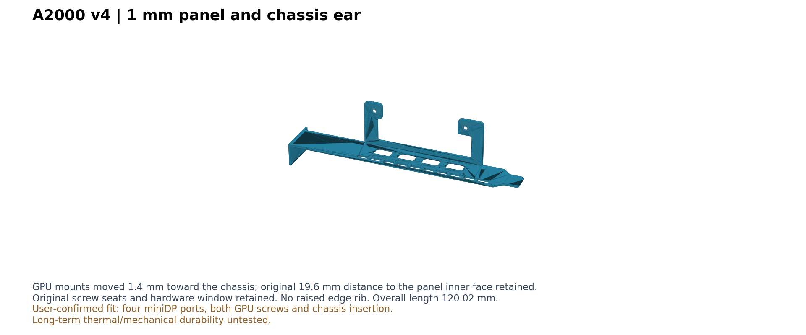

# RTX A2000 单槽全高挡板

用于 **NVIDIA RTX A2000 12GB、已改装单槽散热器** 的 PETG 打印挡板。当前版本 **v4** 已由制作者实物确认：四个 miniDP 接口、两个显卡固定螺孔及装卡后的机箱安装均正常。

这是单套硬件上的装配验证；散热器和机箱的具体型号未记录。未验证其他改装方案，也未记录长期热环境、承载强度、锁扣寿命或电气功能测试。



## 下载与打印

- [完整挡板 3MF](models/a2000-full-height-v4-print.3mf)：已按打印方向摆放，仅含模型，不含打印机、材料或切片预设。
- [打印方向 STL](models/a2000-full-height-v4-print.stl)：与上面的 3MF 为同一几何。
- [装配坐标 STL](models/a2000-full-height-v4-assembly.stl)：便于 CAD 检查。
- [OpenSCAD 参数化源码](src/a2000-full-height-v4.scad)。

单位为 **mm**，导入比例为 **100%**。实际使用材料为 PETG；打印机、喷嘴、层高、填充及支撑参数未完整记录。打印方向有固定耳悬空区域，切片时检查支撑和首层接触。1 mm 面板较柔软，不能按同厚金属挡板的刚度使用。

试装时先轻带显卡上的两颗螺丝，检查背面定位柱和焊脚是否避开、四个插头是否能顺畅插入。装入机箱后，确认金手指自然完全入槽、挂耳落位，再锁机箱螺丝；不要用螺丝强拉显卡入槽。

## 关键参数

以下是本模型采用并完成本次试装的尺寸，不代表所有 A2000 改装件的通用规格。

| 项目 | v4 数值 |
|---|---:|
| 挡板总长 | 120.02 mm |
| 主面板宽度 | 18.42 mm |
| 主面板 / 机箱挂耳厚度 | 1.0 / 1.0 mm |
| 插舌末端无加厚结构的长度 | 20 mm，厚度 1.0 mm |
| 四个 miniDP 开孔中心间距 | 12.7 mm |
| 单个 miniDP 内口包络 | 8.8 × 6.0 mm，轮廓见源码 |
| 外部锁片槽 | 7.2 × 1.8 mm |
| 锁片承接处厚度 | 1.0 mm |
| 两个 GPU 螺孔中心间距 | 48 mm |
| GPU 通孔 / 螺丝头让位直径 | 2.2 / 5.0 mm |
| 螺丝孔座剩余厚度 | 1.0 mm |
| PCB 背面新增贯穿避让区域 | 50 × 13 mm，圆角 R1，与原开窗合并 |
| GPU 孔中心距主面板内侧 | 19.6 mm |
| 打印方向整体包围尺寸 | 120.02 × 36.63 × 21.59 mm |

挂耳到首个接口中心采用 47.44 mm：来自早期实测开孔边距约 43.04 mm，再加模型半孔宽 4.4 mm。这是建模取值，不是接口规范规定的位置。

源码坐标：X 沿四个接口排列方向，Y 横跨挡板宽度，Z 从机箱侧外表面指向显卡。v4 的 GPU 孔中心为 `(13.7, 20.6)`、`(61.7, 20.6)`（X/Z）；接触定位面为 `Y=17.2`。

## 修改与验证记录

| 版本 | 发现的问题与调整 |
|---|---|
| v1 | 初版机箱挂耳与插舌方向反了；一个螺丝能够穿孔但够不到散热器螺纹；缺少线缆外部锁片让位。 |
| v2 | 修正机箱两端方向；在保留 PCB 定位面的同时加螺丝头让位，孔座剩余 1 mm；增加外部锁片槽。螺丝可用，但 PCB 背面凸起使安装不平，接口逐渐错位；插舌薄区不足。 |
| v3 | 扩大贯穿避让窗，避开接口定位柱和固定焊脚；去掉向 PCB 侧突出的根部斜撑，保留螺孔定位垫；末端薄区延长至 20 mm。用户确认四口和两螺孔完全适配，但整卡装机受阻。 |
| v4 | 主面板、机箱挂耳及末端均减至 1 mm，取消边缘加厚筋；GPU 固定结构整体沿 Z 移动 −1.4 mm，保持显卡与主面板内侧的关系。用户确认整卡机箱安装无问题。 |

最后一次实物反馈日期：**2026-11-06**。本仓保留最终 v4；旧版问题在此记录，避免误打未完成的版本。

[validation.json](validation.json) 记录了模型检查和用户反馈，二者分开标注。网格检查包括单一封闭实体、孔座与避让结构、关键尺寸，以及 3MF 回读后尺寸和体积一致。模型检查不等同于机械强度测试。

## 从源码导出

在仓库根目录使用 OpenSCAD：

```sh
openscad -o models/a2000-full-height-v4-print.stl src/a2000-full-height-v4.scad
openscad -D 'print_orientation=false' -o models/a2000-full-height-v4-assembly.stl src/a2000-full-height-v4.scad
```

Nix 环境可临时使用 `nix-shell -p openscad`。将打印 STL 导入切片软件后可另存 3MF；本仓提供的 3MF 仅是模型容器，不依赖某款切片软件的工程设置。

## 来源与许可

GPU 安装翼及 miniDP 开孔几何改编自 **mr4lexndr** 的 [Rear Bracket for RTX A2000 Lenovo Tiny 5](https://makerworld.com/en/models/2000710)。原始 3MF 元数据声明许可为 **BY-NC-SA**，没有注明版本号或许可 URL；本仓保留该许可声明及署名，不擅自补写版本号。详见 [LICENSE](LICENSE)。

本次改动包括单槽全高外形、机箱端方向、螺丝头让位、外部锁片槽、PCB 背面避让、1 mm 面板与挂耳，以及安装深度调整。源码保留了来源说明；接口锁片槽等试装参数不应引用为 miniDP 标准尺寸。
